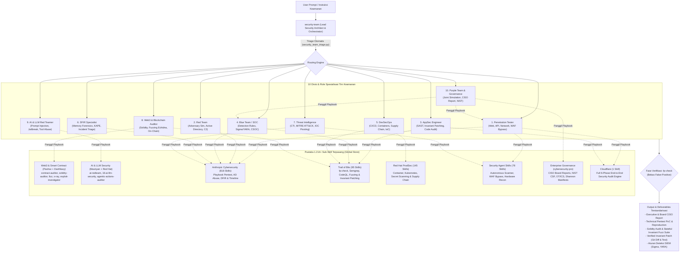

# Security Team Skill: Enterprise Cybersecurity Orchestrator

The **`security-team`** skill transforms your AI agent into a complete, 10-division enterprise cybersecurity organization. It functions as a **Lead Security Architect & Orchestrator**, intelligently routing requests to the appropriate specialized security roles and executing targeted procedures drawn from a global library of **1,214+ installed security sub-skills**.

---

## 1. Topologi Arsitektur & Alur Kerja



---

## 2. Cara Kerja Sistem

1. **Penerimaan Instruksi (Input Layer)**:
   * Anda memberikan perintah keamanan (misal: pengujian aplikasi web, audit kode Solidity, simulasi APT, atau investigasi insiden).
2. **Triage & Routing Otomatis**:
   * Skrip `security_team_triage.py` menganalisis konteks perintah menggunakan pencocokan kata kunci dan intent untuk memilih **Lead Role** dan peran pendukung.
3. **Penyusunan Rencana & Penarikan Playbook**:
   * Peran yang ditugaskan mengaktifkan modul dan panduan teknis spesifik dari 1.214+ sub-skill yang telah terpasang secara lokal di sistem Anda.
4. **Verifikasi Bebas False-Positive (`fp-check`)**:
   * Sebelum menetapkan temuan, agen membuktikan kontrol input, memeriksa jalur data ke vulnerable sink, dan memverifikasi keterlaksanaan eksploitasi di kondisi nyata.
5. **Remediasi Tingkat Invariansi**:
   * Jika diminta perbaikan, AppSec Engineer membuat patch terkecil yang memperbaiki akar masalah (root-cause invariant) dan mengujinya kembali.
6. **Pelaporan Terstandarisasi**:
   * Hasil disajikan dalam format siap pakai untuk manajemen eksekutif (skor risiko, kepatuhan) maupun tim teknis (PoC curl/script, diff kode, aturan deteksi Sigma).

---

## 3. Katalog Prompt Lengkap (Semua Fitur & 10 Peran)

Gunakan contoh-contoh prompt di bawah ini untuk mengaktifkan fitur dan peran spesifik secara optimal:

### Divisi 1: Penetration Testing (Pentester)
* **1.1. Web Application Pentest**:
  > *"Bertindaklah sebagai Penetration Tester. Lakukan pengujian penetrasi komprehensif pada aplikasi web di URL ini, fokus pada OWASP Top 10 (SQLi, XSS, SSRF, IDOR). Berikan langkah reproduksi non-destruktif dan perintah curl untuk verifikasi."*
* **1.2. API Security & BOLA/IDOR Testing**:
  > *"Tolong uji keamanan REST API dan GraphQL endpoint kami. Periksa kerentanan Broken Object Level Authorization (BOLA), mass assignment, dan bypass rate-limiting. Gunakan sub-skill api-security-testing."*
* **1.3. WAF Bypass Assessment**:
  > *"Sebagai Pentester, uji efektivitas WAF kami dengan payload injeksi yang di-obfuscate menggunakan chunked encoding, double URL encoding, dan parameter pollution. Gunakan sub-skill waf-bypass-techniques."*
* **1.4. Network Perimeter & Port Audit**:
  > *"Lakukan simulasi pengujian penetrasi jaringan eksternal. Petakan port yang terbuka, layanan rentan (SMB, RDP, SSH), dan berikan rekomendasi penguatan perimeter jaringan."*

---

### Divisi 2: Red Team (Adversary Emulation)
* **2.1. Active Directory Attack Simulation**:
  > *"Sebagai Red Team, simulasikan attack path pada Active Directory domain kami menggunakan metodologi BloodHound. Analisis celah Kerberoasting, AS-REP roasting, dan kemungkinan eskalasi privilese via DCSync atau Shadow Credentials."*
* **2.2. Windows Credential Access (DPAPI)**:
  > *"Analisis mekanisme ekstraksi kredensial DPAPI dan master keys pada workstation Windows. Berikan skenario pengujian kredensial di memory dan bagaimana memitigasinya."*
* **2.3. Lateral Movement & Stealth C2**:
  > *"Rancang skenario simulasi serangan lateral movement menggunakan Living-off-the-Land Binaries (LOLBins) tanpa memicu deteksi antivirus standar."*

---

### Divisi 3: AppSec Engineer (Code Review & SAST)
* **3.1. Full Codebase Security Audit**:
  > *"Bertindaklah sebagai AppSec Engineer. Jalankan 6-phase security audit pada codebase repositori ini. Petakan batas kepercayaan, input surface, dan lakukan static analysis untuk menemukan kerentanan logika dan memori."*
* **3.2. Eliminasi False Positive (`fp-check`)**:
  > *"Tinjau laporan kerentanan berikut dan jalankan verifikasi fp-check untuk membuktikan secara matematis dan alur data apakah temuan ini benar-benar exploitable atau false positive."*
* **3.3. Invariant Security Patching**:
  > *"Buatkan patch perbaikan tingkat invariansi untuk kerentanan SQL injection / IDOR ini menggunakan metodologi patching-bugs. Pastikan perbaikan tidak merusak fungsionalitas aplikasi dan sertakan automated test."*
* **3.4. Language-Specific Audit (C/C++, Rust, Go)**:
  > *"Lakukan audit keamanan khusus memori pada kode C/C++ ini (buffer overflow, use-after-free, integer truncation) dan periksa unsafe blocks pada modul Rust terkait."*

---

### Divisi 4: Blue Team / SOC Analyst & Detection Engineering
* **4.1. Pembuatan Aturan Deteksi Sigma**:
  > *"Sebagai Detection Engineer, buatkan aturan deteksi Sigma standar untuk mendeteksi eksekusi mimikatz, credential dumping via LSASS, dan request anomali pada web server."*
* **4.2. Penulisan YARA Rules**:
  > *"Tolong buatkan rule YARA untuk mendeteksi sampel webshell dan binary malware berbasis karakteristik string hex dan section header yang mencurigakan."*
* **4.3. CSOC Alert Triage & SPL Query**:
  > *"Analisis alert keamanan SIEM Splunk berikut. Tentukan prioritas insiden (L1-L3), korelasi log event ID Windows yang relevan, dan buatkan SPL query untuk melacak penyebaran serangan."*

---

### Divisi 5: DevSecOps & Cloud Security
* **5.1. Audit Pipeline CI/CD**:
  > *"Bertindaklah sebagai DevSecOps Engineer. Audit workflow GitHub Actions kami dari risiko ekspresi injection, secret leakage, dan konfigurasi runner yang tidak aman menggunakan agentic-actions-auditor."*
* **5.2. Hardening Kontainer Docker & Kubernetes**:
  > *"Audit Dockerfile dan manifest Kubernetes berikut. Terapkan Pod Security Standards, non-root user, distroless base image, dan batasi network policy antar-namespace."*
* **5.3. Supply Chain Security & SBOM**:
  > *"Periksa dependency tree project ini dari risiko typosquatting, dependency confusion, dan verifikasi integritas checksum package serta SLSA provenance."*

---

### Divisi 6: DFIR Specialist (Forensik & Penanganan Insiden)
* **6.1. Incident Triage & Breach Containment**:
  > *"Kami mendeteksi aktivitas mencurigakan pada server produksi. Bertindaklah sebagai DFIR Specialist, pandu langkah containment darurat berdasarkan PICERL framework, dan buatkan rencana isolasi jaringan."*
* **6.2. Forensic Timeline Reconstruction**:
  > *"Bantu analisis artefak forensik Windows ($MFT, Prefetch, Shimcache, Event Logs) menggunakan metodologi KAPE dan Hayabusa untuk menyusun kronologi insiden dari titik masuk hingga dampak."*
* **6.3. Analisis Memory Dump (Volatility)**:
  > *"Berikan panduan analisis memory dump menggunakan Volatility 3 untuk mengidentifikasi proses yang di-inject (process hollowing), koneksi jaringan aktif, dan mendeteksi driver rootkit."*

---

### Divisi 7: Threat Intelligence Analyst
* **7.1. Pemetaan MITRE ATT&CK & Threat Actor Profiling**:
  > *"Profil kelompok ancaman APT yang menargetkan sektor finansial/e-commerce. Petakan TTP mereka ke matriks MITRE ATT&CK Enterprise dan identifikasi indikator kompromi (IOC) utamanya."*
* **7.2. Threat Hunting Berbasis Hipotesis**:
  > *"Sebagai Threat Hunter, buatkan hipotesis perburuan ancaman untuk mendeteksi C2 beaconing dengan interval frekuensi tertentu di dalam log DNS dan flow data jaringan."*

---

### Divisi 8: Web3 & Blockchain Security Auditor
* **8.1. Audit Smart Contract Solidity**:
  > *"Bertindaklah sebagai Web3 Security Auditor. Audit smart contract Solidity ini secara mendalam untuk menemukan reentrancy, manipulasi oracle, privilege access bypass, dan precision loss (WAD/RAY)."*
* **8.2. Stateful Invariant Fuzzing Harness**:
  > *"Gunakan skill fizz dan fizz-convert untuk membangun harness stateful fuzzing berbasis Echidna/Medusa pada protokol DeFi kami, serta definisikan invariansi solvabilitas tokennya."*
* **8.3. On-Chain Incident Investigation**:
  > *"Analisis transaksi eksploitasi on-chain dengan hash 0x... ini menggunakan exploit-investigator. Dekonstruksi alur transaksi, flash loan yang digunakan, dan celah logika yang dimanfaatkan attacker."*

---

### Divisi 9: AI & LLM Red Teamer
* **9.1. Direct Prompt Injection & Jailbreaking**:
  > *"Bertindaklah sebagai AI Red Teamer. Uji ketahanan model LLM kami terhadap teknik direct prompt injection, jailbreaking persona, encoding bypass, dan token splitting sesuai OWASP LLM01."*
* **9.2. Indirect Prompt Injection via RAG**:
  > *"Simulasikan serangan indirect prompt injection di mana dokumen eksternal pada pipeline RAG disusupi instruksi tersembunyi untuk membajak perilaku agen AI."*
* **9.3. Audit Hak Akses Tool Agen AI (Excessive Agency)**:
  > *"Audit konfigurasi MCP tool server dan pemanggilan fungsi pada agen AI kami. Pastikan tidak ada celah di mana model dapat dipaksa mengeksekusi perintah shell destruktif tanpa konfirmasi pengguna."*

---

### Divisi 10: Purple Team & CISO Governance
* **10.1. Latihan Kolaborasi Purple Team**:
  > *"Sebagai Purple Team Lead, jalankan simulasi serangan terkoordinasi untuk teknik Kerberoasting / WAF Bypass sekaligus verifikasi apakah deteksi SIEM mencatat event tersebut. Laporkan gap visibilitas yang ditemukan."*
* **10.2. Laporan Eksekutif CISO & Kepatuhan GRC**:
  > *"Susun laporan tata kelola cyber-risk tingkat CISO dan Board of Directors berdasarkan standar NIST CSF dan ISO 27001 menggunakan kapabilitas cybersecurity-pro. Sajikan ringkasan kuantitatif risiko bisnis dan roadmap mitigasi."*

---

## 4. Struktur File

```text
security-team/
├── SKILL.md                          # Panduan orkestrasi & routing matrix 10 peran
├── README.md                         # Dokumentasi lengkap, topologi, & katalog prompt
├── references/
│   ├── role-descriptions.md          # Rincian teknis 10 divisi
│   ├── pentest-team-playbook.md      # Runbook taktis tim Penetration Testing
│   ├── web3-smart-contract-playbook.md # Runbook audit smart contract & fuzzing
│   ├── ai-llm-redteam-playbook.md    # Runbook pengujian AI/LLM & prompt injection
│   ├── engagement-types.md           # SOP 9 tipe engagement keamanan
│   ├── escalation-procedures.md      # Matriks CVSS & protokol eskalasi temuan
│   ├── purple-team-playbook.md       # Panduan latihan gabungan Red + Blue
│   └── security-report-templates.md  # Template laporan CISO, Pentest, Web3, & AI
└── scripts/
    └── security_team_triage.py       # Skrip CLI triage otomatis untuk analisis prompt
```
